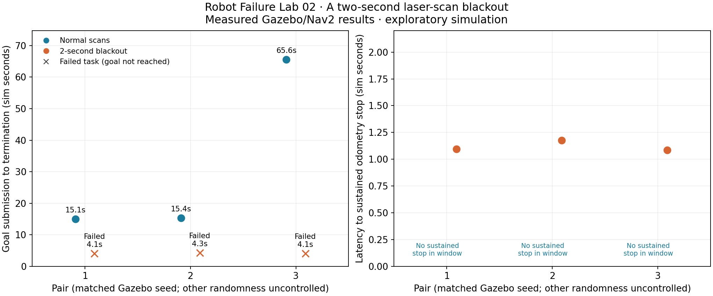
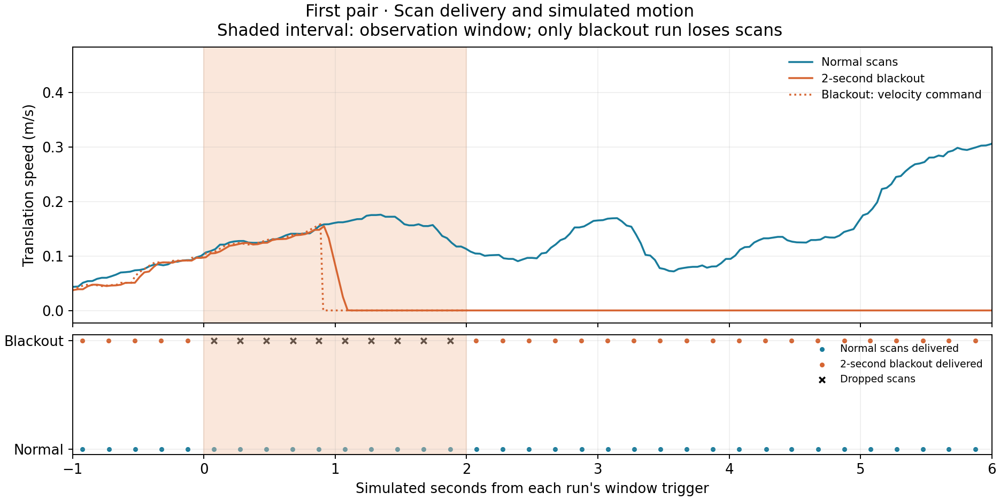

# Robot Failure Lab 02: the scans returned; did the task recover?

Executed October 18, 2026 in Gazebo/Nav2 simulation. Six planned trials: three
normal and three with a two-second laser-scan transport blackout.

## Measured result

- Normal navigation reached the goal in 3/3 trials.
- Blackout navigation reached the goal in 0/3 trials.
- A sustained odometry stop was measured during the blackout in 3/3 trials.
- Motion resumed after the window in 0/3 blackout trials during the recorded observation period.
- Blackout stop latency ranged from 1.086 to 1.176 simulated seconds after onset.

| Pair | Normal outcome / time | Blackout outcome / time | Blackout stop after onset | Blackout task error |
| --- | --- | --- | --- | --- |
| 1 | succeeded / 15.051 s | failed / 4.053 s | 1.095 s | 102 |
| 2 | succeeded / 15.354 s | failed / 4.260 s | 1.176 s | 102 |
| 3 | succeeded / 65.553 s | failed / 4.056 s | 1.086 s | 102 |

These are task termination times. A failed task terminating earlier did not
complete the journey faster. All three blackout windows have validated scan
drop/delivery evidence, including uninterrupted upstream sensing and resumed
forwarding afterward.

## What the evidence means

The logs below distinguish a stale-sensor stop from task outcome. FollowPath
defines error 102 as TF_ERROR in the installed Nav2 interface: a failure to
obtain a required coordinate transform. The robot uses these transforms to
relate its position estimate to the map. Check each trial's errors rather than
assuming that every failure has the same cause.

Stopping, restoring sensor delivery and resuming a navigation task are separate
behaviors. A stopped robot with an aborted goal has not demonstrated automatic
task recovery. This is a useful reason to test both sensor restoration and goal
outcome. No replacement goal was sent.

The scan relay fed localization, both obstacle maps and the collision monitor;
the outage was not isolated to obstacle sensing. Odometry, IMU and the static
map remained available. The collision monitor's one-second source timeout was
unchanged. We have not isolated which consumer or timeout caused every part of
the behavior. A later experiment could separate localization input from obstacle
sensing while preserving a fresh input to the collision monitor, but that would
be a new protocol.

## Limits

Three trials per condition, one static map/route and simulator only. Gazebo seeds
were paired (101, 102, 103); AMCL randomness and host scheduling were uncontrolled.
This is not a population failure-rate estimate, physical safety validation or
proof about Nav2 in general. The task was already moving when each trigger fired,
but exact trigger positions were not matched. The original Lab 01 delay question
remains unresolved. Vektor capture/comparison was not integrated; no product
performance or adoption claim follows. Nothing was publicly posted.

## Checks and retained attempts

Six pure-logic/metric tests passed. All six main records passed scan-by-scan
gating, upstream continuity, sensor age, resumed delivery, telemetry continuity,
live topic routing and recomputed metric checks. Source hashes and exact installed
versions are retained. Figures were reviewed separately before delivery.

Two smoke pairs preceded the main series and are excluded from its six trials.
The first found that early task abort truncated observation; the second verified
continued passive recording. Two attempted main launches hung before navigation
readiness, without a goal or blackout. Their logs are retained as infrastructure
failures. A 60-second startup-readiness bound and guarded continuation were added.
All completed task outcomes were preserved. Main trials used ROS domains 189/190
with the same frozen worker/configuration. See excluded-checks/README.md.

## Figures





## Selected main-trial log evidence

### pair-1-normal

Action error code: 0.

```text

```

### pair-1-blackout

Action error code: 102.

```text
[collision_monitor-17] [WARN] [1792349773.700888713] [collision_monitor]: Robot to stop due to invalid source. Either due to data not published yet, or to lack of new data received within the sensor timeout, or if impossible to transform data to base frame
[controller_server-9] [ERROR] [1792349773.806632373] [controller_server]: Exception in transformPose: Lookup would require extrapolation into the future.  Requested time 20.412000 but the latest data is at time 20.401000, when looking up transform from frame [map] to frame [odom]
[controller_server-9] [ERROR] [1792349773.806734519] [controller_server]: Unable to transform goal pose into costmap frame
[bt_navigator-14] [ERROR] [1792349773.833258877] [bt_navigator]: Goal failed
```

### pair-2-blackout

Action error code: 102.

```text
[collision_monitor-17] [WARN] [1792349800.082977473] [collision_monitor]: Robot to stop due to invalid source. Either due to data not published yet, or to lack of new data received within the sensor timeout, or if impossible to transform data to base frame
[controller_server-9] [ERROR] [1792349800.177895344] [controller_server]: Exception in transformPose: Lookup would require extrapolation into the future.  Requested time 18.612000 but the latest data is at time 18.601000, when looking up transform from frame [map] to frame [odom]
[controller_server-9] [ERROR] [1792349800.178028257] [controller_server]: Unable to transform goal pose into costmap frame
[controller_server-9] [ERROR] [1792349800.288305066] [controller_server]: Exception in transformPose: Lookup would require extrapolation into the future.  Requested time 18.720000 but the latest data is at time 18.601000, when looking up transform from frame [map] to frame [odom]
[controller_server-9] [ERROR] [1792349800.288402987] [controller_server]: Unable to transform goal pose into costmap frame
[bt_navigator-14] [ERROR] [1792349800.314749273] [bt_navigator]: Goal failed
```

### pair-2-normal-attempt-2

Action error code: 0.

```text

```

### pair-3-normal

Action error code: 0.

```text

```

### pair-3-blackout

Action error code: 102.

```text
[collision_monitor-17] [WARN] [1792350068.621197630] [collision_monitor]: Robot to stop due to invalid source. Either due to data not published yet, or to lack of new data received within the sensor timeout, or if impossible to transform data to base frame
[controller_server-9] [ERROR] [1792350068.736311384] [controller_server]: Exception in transformPose: Lookup would require extrapolation into the future.  Requested time 20.448000 but the latest data is at time 20.401000, when looking up transform from frame [map] to frame [odom]
[controller_server-9] [ERROR] [1792350068.736409212] [controller_server]: Unable to transform goal pose into costmap frame
[bt_navigator-14] [ERROR] [1792350068.764277183] [bt_navigator]: Goal failed
```
