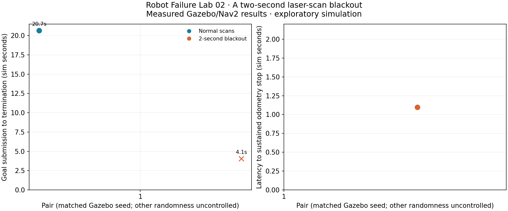
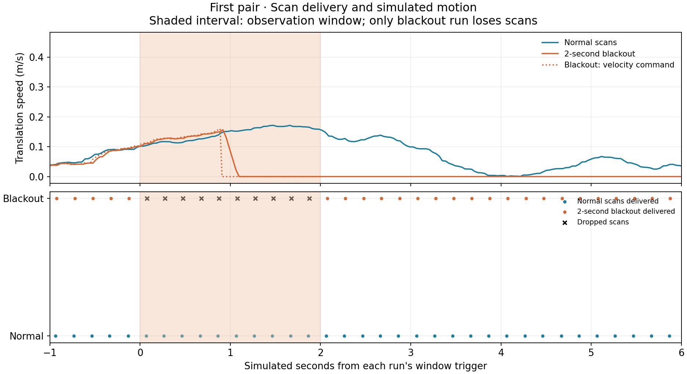

# Robot Failure Lab 02: What happens during a two-second scan blackout?

Measured Gazebo/Nav2 simulation. Standalone runner; no Vektor integration or physical validation.

| Pair | Condition | Outcome | Task time (sim s) | Dropped scans | Stop latency (s) | Resume after window (s) | Recoveries |
| --- | --- | --- | --- | --- | --- | --- | --- |
| 1 | Normal scans | succeeded | 20.652 | 0 | — | — | 0 |
| 1 | 2-second blackout | failed | 4.053 | 10 | 1.098 | — | 0 |

## Observations

- Normal scans: 1/1 reached the goal; 0/1 showed a sustained odometry stop during the observation window. Median successful task time: 20.652 simulated seconds.
- 2-second blackout: 0/1 reached the goal; 1/1 showed a sustained odometry stop during the observation window.

## Method and limits

- Fresh simulator and Nav2 per trial; original Lab 01 map, start (-2,-0.5), goal (1,0.5), yaw 0. Three pairs by default; alternating order.
- After at least 3 simulated seconds and sustained translation >=0.05 m/s for 0.3 seconds, mark a two-second window. Control passes all scans. Blackout discards newly received scans; no buffering or replay; original acquisition timestamps retained.
- Live graph verifies AMCL, local/global costmaps and collision monitor subscribe to the relay. Odometry and other sensors remain available. This models a scan transport outage, not complete robot blindness.
- Installed collision monitor source_timeout: 1.0 seconds, unchanged between conditions. Both arms wait 1.5 simulated seconds after Nav2 readiness before goal submission.
- A stop requires odometry translation <=0.01 m/s and absolute yaw rate <=0.03 rad/s for >=0.3 s, with sample gaps <=0.15 s. Reported latency is the start of that confirmed interval. Resumption is >=0.05 m/s for >=0.3 s after window end, only when a stop was measured. A dash means no qualifying event, not a zero latency.
- Velocity commands are observed separately; odometry is simulated motion feedback, not independent physical ground truth. No new obstacle, collision metric or safety certification is included.
- Gazebo seeds 101,102,103 are matched per pair. AMCL randomness, host scheduling and exact trajectory/trigger position are not controlled. This does not establish a causal completion-time effect or general reliability.
- Timeouts/failures are outcomes, not successful completion times. When a task terminates early, passive telemetry continues until at least four seconds after the blackout; no new goal is sent. A stopped robot after task abort is not proof that navigation will resume automatically. Infrastructure errors are retained separately. Original Lab 01 delay uncertainty remains unresolved.
- Evidence validation checks every scan against the planned gate, upstream scans during the blackout, prompt delivery afterward, odometry continuity and recalculated metrics.
- sources/, PROTOCOL.json, params.yaml, packages.txt and per-trial CSVs/logs preserve provenance. Publication has not occurred.

